# TuneLab 用户手册

TuneLab 是一款**可扩展的歌声合成编辑器**：合成引擎、工程格式、音频效果器与乐器音源均由扩展提供；编辑器负责音符、歌词、音高、参数与音素的编辑，并内置脚本与 AI Agent 用于批量操作。

本手册介绍界面各区域、各工具的操作方式、侧栏各页、设置项，以及文件与扩展管理。

> 插图中的「示例声源 · 澄」「示例乐器 · 正弦」为演示用的占位插件，实际使用时显示的是已安装的引擎。

---

## 目录

1. [安装与启动](#1-安装与启动)
2. [界面总览](#2-界面总览)
3. [快速上手](#3-快速上手)
4. [轨道区（编排）](#4-轨道区编排)
5. [走带与功能栏](#5-走带与功能栏)
6. [钢琴窗：音符与歌词](#6-钢琴窗音符与歌词)
7. [钢琴窗：音高与颤音](#7-钢琴窗音高与颤音)
8. [钢琴窗：音素](#8-钢琴窗音素)
9. [钢琴窗：波形与合成状态](#9-钢琴窗波形与合成状态)
10. [参数面板](#10-参数面板)
11. [侧栏](#11-侧栏)
12. [设置](#12-设置)
13. [快捷键](#13-快捷键)
14. [文件、格式与自动保存](#14-文件格式与自动保存)
15. [扩展管理](#15-扩展管理)
16. [更新与排错](#16-更新与排错)
17. [命令行与外部工具](#17-命令行与外部工具)
- [附录：术语表](#附录术语表)

---

<!-- section: install -->
## 1. 安装与启动

Release 页面提供以下两种 Windows x64 安装包：

| 形态 | 文件名 | 说明 |
|------|--------|------|
| 安装器 | `TuneLab-Setup-win-x64-v<版本>.exe` | 安装到 `%LocalAppData%\Programs\TuneLab`（仅当前用户，无需管理员权限）；可选择关联 `.tlpx` / `.tlp` / `.tlx` 文件类型，并注册卸载项。**仅安装版支持自动更新。** |
| 免安装 | `TuneLab-win-x64-v<版本>.zip` | 解压到任意目录后运行 `TuneLab.exe`。不关联文件类型，不注册卸载项，不支持自动更新。 |

两种包均为**框架依赖**构建，需要安装 [.NET 8 Desktop Runtime](https://dotnet.microsoft.com/download/dotnet/8.0)（x64）。未安装运行时的机器首次启动时会引导至微软下载页面。

程序未进行代码签名，首次启动时 Windows 可能显示 SmartScreen 提示（“Windows 已保护你的电脑”），依次选择 **更多信息 → 仍要运行** 即可。

其他平台请从源码自行构建。

### 无人值守安装（脚本 / AI Agent）

安装器支持命令行参数，向导中的每个选项都有对应参数，**默认值与向导一致**（创建快捷方式、关联文件类型、安装完成后启动）。运行 `TuneLab-Setup-win-x64-v<版本>.exe -help` 可列出全部参数及默认值。

在尚未安装运行时的机器上，安装步骤如下（PowerShell）：

```powershell
# 1) 安装运行时（框架依赖构建的前提）
winget install --id Microsoft.DotNet.DesktopRuntime.8 --silent --accept-package-agreements

# 2) 下载最新安装器
$api = Invoke-RestMethod https://api.github.com/repos/LiuYunPlayer/TuneLab/releases/latest
$url = ($api.assets | Where-Object { $_.name -like 'TuneLab-Setup-win-x64-*.exe' }).browser_download_url
$exe = Join-Path $env:TEMP (Split-Path $url -Leaf)
Invoke-WebRequest $url -OutFile $exe
Unblock-File $exe          # 移除“从网络下载”标记，避免运行时被 SmartScreen 拦截

# 3) 静默安装（以下为 CI 常用参数：不创建快捷方式、不关联文件类型、安装后不启动）
#    安装器是窗口程序，PowerShell 的 & 不会等待其结束，须使用 Start-Process -Wait，
#    否则第 4 步会在安装完成前执行，且无法获取退出码（见下文）
$setup = Start-Process $exe -Wait -PassThru -ArgumentList @(
    '-silent',
    '-desktop-shortcut', 'false',
    '-start-menu-shortcut', 'false',
    '-file-assoc', 'false',
    '-launch', 'false')
if ($setup.ExitCode -ne 0) {
    throw "TuneLab 安装失败，退出码 $($setup.ExitCode)，详见 $env:TEMP\TuneLab.Setup.log"
}
#    仅保留 @('-silent') 即为与向导默认一致的安装
#    -dir <path> 指定安装目录；-language zh-CN 指定界面语言

# 4) 验证安装（命令行工具位于安装目录；若指定了其他目录，请相应替换路径）
& "$env:LOCALAPPDATA\Programs\TuneLab\tunelab.cmd" --headless app info
```

退出码：`0` 成功 / `1` 安装失败 / `2` 参数错误。**仅在等待安装器结束的调用方式下才能获取退出码**：安装器属于 GUI 子系统程序，PowerShell 的 `&` 与 cmd 中的直接调用均不等待其结束，此时 `$LASTEXITCODE` 为空，后续步骤会与安装同时执行。PowerShell 请使用上文的 `Start-Process -Wait -PassThru` 读取 `.ExitCode`，cmd 请使用 `start /wait`。静默安装的过程记录在 `%temp%\TuneLab.Setup.log`。

注意事项：

- **TuneLab 运行时无法安装**（文件被占用）。静默安装会等待 20 秒，届时仍未退出则报错退出。
- **`-dir` 指定的即最终安装目录**：文件直接安装到该路径下，不会再创建 `TuneLab\` 子目录。向导中的「浏览」按钮会自动追加该子目录（选择 `D:\Apps` 得到 `D:\Apps\TuneLab`），命令行则不追加。未指定时使用默认目录 `%LocalAppData%\Programs\TuneLab`。
- **卸载**：`TuneLab-Setup-win-x64-v<版本>.exe -uninstall <安装目录>`，或安装目录中的 `TuneLab.Setup.exe -uninstall <安装目录>`。卸载只删除安装时记录在 `install-manifest.txt`（位于安装目录）中的文件，用户自行放入该目录的文件会保留；目录在清空后才会删除。
- **每台机器仅支持一份安装**：快捷方式、文件关联与卸载项均使用固定名称，再次安装会覆盖已有的注册信息。
- 安装完成后，脚本与 AI Agent 可直接通过 `tunelab --headless …` 执行任务（运行脚本修改工程、批量导出等），**无需开启命令桥**；仅在需要操作**用户当前打开的窗口**时，才需要由用户在设置中开启命令桥，见[命令行与外部工具](#17-命令行与外部工具)。

### 用户数据位置

除程序文件外，TuneLab 的全部用户数据位于 `%APPDATA%\TuneLab`：

| 位置 | 内容 |
|------|------|
| `Configs\Settings.json` | 设置窗中的全部设置 |
| `Configs\Keybindings.json` | 修改过的快捷键（仅保存改动项，其余沿用默认值） |
| `Configs\EditorState.json` | 窗口位置、面板高度等界面状态 |
| `Configs\ExtensionActivation.json` | 扩展及其单项功能的启用状态 |
| `Configs\ExtensionRouting.json` | 多个扩展提供同一功能时的选择 |
| `Configs\ParameterPins.json` | 钉选到参数面板的属性 |
| `Extensions\` | 已安装的扩展（每个包一个子目录） |
| `Scripts\` | 保存的脚本 |
| `AgentSessions\` | AI Agent 的会话记录 |
| `AutoSave\` | 自动保存的备份 |
| `Logs\` | 运行日志 |

可通过菜单 **帮助 → 打开 TuneLab 文件夹 / 打开日志** 直接打开。

---

<!-- section: ui-overview -->
## 2. 界面总览

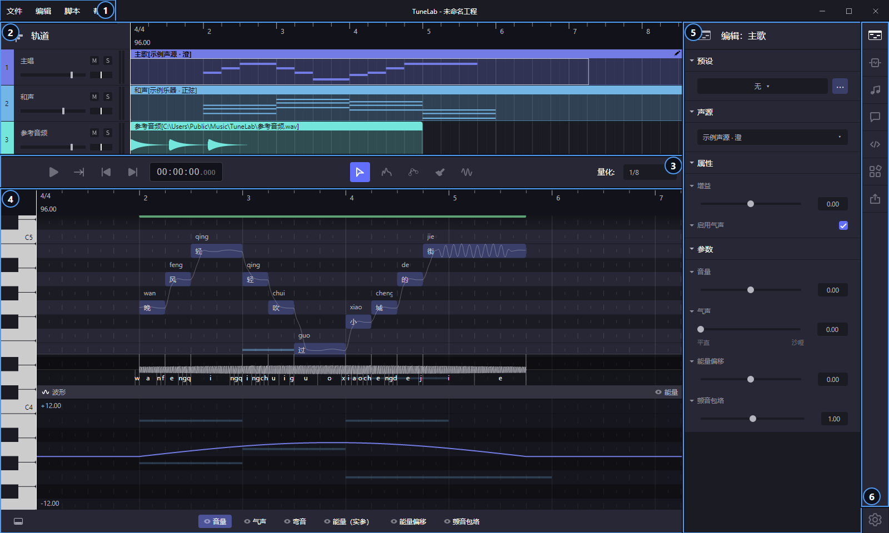

| # | 区域 | 作用 |
|---|------|------|
| ① | **菜单栏** | 文件 / 编辑 / 脚本 / 帮助。标题栏中间显示当前工程名，有未保存的改动时会在标题上标示。 |
| ② | **轨道区（编排区）** | 整首歌的横向布局：轨道、片段、时间轴（节奏与拍号）。 |
| ③ | **功能栏** | 走带控制、时间码、五个编辑工具、量化设置。 |
| ④ | **钢琴窗** | 编辑当前打开的片段：音符、歌词、音高、颤音、音素、参数。 |
| ⑤ | **侧栏** | 打开的面板并排显示，宽度可分别调整。 |
| ⑥ | **侧栏页签条** | 自上而下：片段属性、效果、音符属性、Agent、脚本、扩展、导出；最下方的齿轮打开**设置**窗。 |

轨道区与钢琴窗之间的分界（即功能栏）可上下拖动；侧栏各面板的左缘可左右拖动。侧栏页签单击打开，再次单击关闭。

---

<!-- section: quick-start -->
## 3. 快速上手

1. **准备引擎**：安装一个歌声合成引擎扩展（见[扩展管理](#15-扩展管理)）。未安装引擎时仍可编辑，但无法合成歌声。
2. **新建工程**：`Ctrl+N`。默认包含一条轨道和一个空片段。
3. **选声源**：在轨道区右键单击该片段 → **设置声源**，选择音色。
4. **打开片段**：双击片段，在下方钢琴窗中打开。
5. **写音符**：选择**音符工具**（功能栏第 1 个，快捷键 `1`），在钢琴窗空白处**双击**新建音符；双击后按住向右拖动可直接设定长度。
6. **填歌词**：双击音符输入歌词；或框选多个音符后右键 → **输入歌词**，一次输入整句。
7. **试听**：`Space` 播放/暂停，`Home` 回到开头。合成在后台增量进行，钢琴窗顶部的状态条显示各段的合成进度。
8. **修音高**：切换到**音高画笔**（`2`）在音符上绘制音高线；需要精细调整时使用**锚点工具**（`3`）。
9. **导出**：在侧栏 **导出** 页选择路径、格式与轨道后导出；仅需整体混音的 WAV 时，可使用菜单 **文件 → 导出混音文件**。
10. **保存**：`Ctrl+S`，默认保存为 `.tlpx`。

---

<!-- section: arrangement -->
## 4. 轨道区（编排）

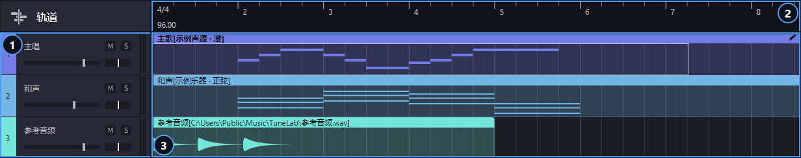

| # | 区域 | 说明 |
|---|------|------|
| ① | **轨道头** | 每条轨道的序号（带轨道颜色）、名称、`M`（静音）/`S`（独奏）、增益与声像两个滑条，右缘还有实时电平表。 |
| ② | **时间轴** | 小节刻度、拍号、速度标记，单击可移动播放头。 |
| ③ | **片段区** | 每条轨道上的片段。歌声/乐器片段显示音符缩略图，音频片段显示波形与文件路径。 |

### 轨道操作

- 通过菜单 **文件 → 添加轨道**，或在片段区空白处右键 → **导入音频轨道 / 导入工程轨道** 添加轨道。导入工程轨道时，轨道选择窗中的轨道**默认全部选中**，取消勾选不需要的轨道即可；导入的轨道若未带颜色（MIDI 等外部格式通常不带），将接续当前工程按调色板顺序分配颜色。
- 轨道头右键：**导出音频**（单独导出该轨道）、**上移**、**下移**、**设置颜色**、**作为参考**（在钢琴窗背景中显示 / 隐藏该轨作为参考）、**删除**。
- 轨道可多选：`Ctrl` + 单击加选 / 减选，拖动可批量调整顺序。**删除**（右键菜单或 `Delete` 键）作用于**全部选中的轨道**，一次撤销即可全部还原。
- 轨道名与序号均可**直接编辑**：双击名称重命名；双击序号输入新序号，轨道即移至该位置。
- 增益、声像、静音、独奏即时生效，仅影响播放与导出的音频。
- 新建轨道的颜色按「轨道色相变化速率」设置自动分配（见[外观设置](#123-外观)）。

### 片段操作

- **移动**：拖动片段（可跨轨道）。
- **裁剪**：拖动片段左右边缘。歌声 / 乐器片段的裁剪只改变可见与发声范围，不会删除音符。
- **打开**：双击片段，在钢琴窗中编辑。`Ctrl+Tab` 重新打开上一个片段。
- **右键菜单**：剪切 / 复制 / 删除、**重命名**、**拆分**（在光标位置切开）、**合并**（将选中的多个片段合并为一个）、**设置声源** / **设置乐器**（含「最近使用」与「内建」）、**去除重叠**、**导出音频**（只导这个片段）。
- 音频文件被移动后，片段会显示「音频加载失败，双击以重新链接。」，双击即可重新指定文件。

### 时间轴：速度与拍号

在时间轴上右键：

- **添加节奏 / 编辑节奏 / 删除节奏**：在该位置插入一个 BPM 变化点。
- **添加节拍 / 编辑节拍 / 删除节拍**：从该小节起改变拍号。

工程起点的速度与拍号始终存在，不可删除，只能编辑。

### 范围选区（DAW 式常驻选区）

按住 **Shift** 在片段区拖动，可绘制一个「时间 × 轨道」的常驻选区，任何工具下均可使用，无需切换工具。选区绘制后：

- 在选区内右键：**复制选区 / 剪切选区 / 删除选区**，以及**粘贴**（粘贴到光标处）；子菜单可仅针对某一类数据（音符 / 音高 / 颤音 / 参数）操作。
- 在选区外右键：仅提供粘贴类操作，因此复制后清除选区，仍可在其他位置粘贴。
- 单击空白处即清除选区。

侧栏「导出」页的**导出范围**可设为「选区」，用于导出选区内的音频。

---

<!-- section: transport -->
## 5. 走带与功能栏


从左到右：**播放/暂停**（`Space`）、**自动翻页**（播放时视图是否跟随播放头，可选择跟随对象）、**跳到起点**（`Home`）、**跳到终点**（`End`）、**时间码**（播放头的绝对时间，毫秒部分以小字显示）。

中间五个为编辑工具，作用于钢琴窗：

| # | 工具 | 快捷键 | 用途 |
|---|------|--------|--------|
| ① | 音符工具 | `1` | 新建、移动、缩放音符，编辑歌词 |
| ② | 音高画笔 | `2` | 手绘音高曲线 |
| ③ | 锚点工具 | `3` | 编辑音高曲线的锚点 |
| ④ | 固定笔刷 | `4` | 将引擎合成的音高固定为可编辑的用户曲线 |
| ⑤ | 颤音工具 | `5` | 添加与调整颤音 |

最右侧的**量化**下拉框决定所有拖动操作的吸附精度：`1/1`～`1/32`（二分族）、`1/3`～`1/96`（三分族）、`1/5`～`1/80`（五分族）。拖动时按住 **Alt** 可临时取消吸附。

---

<!-- section: notes-and-lyrics -->
## 6. 钢琴窗：音符与歌词

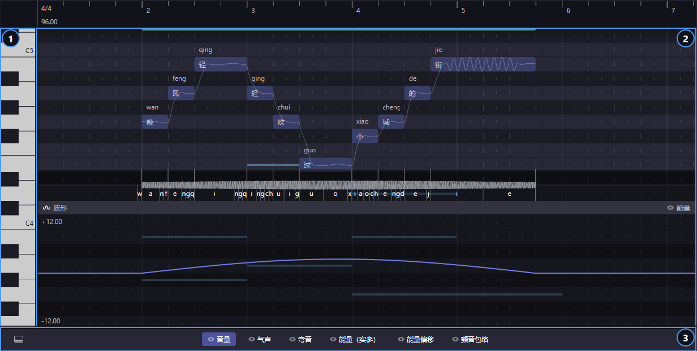

| # | 区域 | 说明 |
|---|------|------|
| ① | **钢琴键** | 纵向音高标尺。单击琴键试听（按住拖过多个键可连续试听），音色取自设置中的「钢琴音采样」。 |
| ② | **音符区** | 显示音符、歌词、发音、音高曲线、颤音与参考轨；下部为波形 / 音素带。 |
| ③ | **参数页签条** | 选择要在参数面板中编辑的参数轨。 |

### 音符编辑（音符工具）


| 操作 | 手势 |
|------|------|
| 新建音符 | 在空白处**双击**（长度为当前量化值），按住继续拖动可直接设定长度 |
| 框选 | 在空白处拖动 |
| 加选 / 减选 | `Ctrl` + 单击 |
| 移动 | 拖动音符 |
| 只改音高、不改位置 | `Shift` + 拖动音符（约束移动） |
| 调整起点 / 终点 | 拖动音符左 / 右边缘 |
| 临时取消吸附 | 拖动时按住 `Alt` |
| 升 / 降半音 | `↑` / `↓` |
| 升 / 降八度 | `Shift+↑` / `Shift+↓` |
| 删除 | `Delete` |
| 全选 | `Ctrl+A` |
| 在光标处切分 | 右键音符 → **拆分** |

音符右键菜单还包括：**输入歌词**、**按音素拆分**、**锁定音素** / **清除锁定音素**、**去除重叠**、**升/降八度**、**由此前置歌词** / **由此后置歌词**（将一串音符的歌词整体前移 / 后移一位）、复制 / 剪切 / 删除、以及**在参数栏编辑**（将音符属性钉选到参数面板）。若安装了脚本工具，适用于音符的脚本也会出现在此菜单中。

### 钢琴窗里的范围选区

钢琴窗同样支持常驻范围选区，形式为**一条时间带**（仅有横向范围，与音高无关）：在空白处按住 **Shift** 拖动即可绘制。它与编排区的选区相互独立。

- 在时间带内右键：**复制选区 / 剪切选区 / 删除选区**，以及**粘贴**；子菜单可仅针对音符 / 音高 / 颤音 / 参数中的某一类操作。
- 有选区时，`Ctrl+C` / `Ctrl+X` / `Delete` 作用于选区，而非当前选中的音符。
- 单击空白处清除选区。
- 例外：音符工具下 `Shift` + 拖动**音符**为约束移动，而非绘制选区：在音符上按下时操作音符，在空白处按下时才绘制选区。

### 歌词与发音


双击音符可直接修改歌词；选中多个音符后右键 **输入歌词**，可一次输入整句并按顺序分配到各音符；勾选**跳过延音符**可跳过用作延音的音符。

- **歌词**是输入的文字，**发音**是提供给引擎的音素来源。发音为空时由引擎决定读音；填写发音后以发音为准（**显式覆盖**）。
- 开启设置中的**录入歌词时自动生成发音**（G2P）后，输入歌词时编辑器会将汉字转为拼音、假名转为罗马字，填入发音字段。该功能仅在**输入**时生效，不会为已有歌词补填发音。
- 多音字：单击音符上方的发音标签，可从引擎或词典提供的候选中选择。
- `-`（延音符）表示延续上一个字。某个记号是否视为延音由引擎判定。

---

<!-- section: pitch-and-vibrato -->
## 7. 钢琴窗：音高与颤音

### 音高曲线


未编辑时，音符上的白线为引擎给出的音高。使用**音高画笔**（`2`）在音符区手绘，即可写入自定义的音高曲线：

- 主键拖动：绘制曲线；`Ctrl` + 拖动：**定值绘制**（以按下时的高度绘制水平线，用于保持某段音高不变）。
- 曲线是分段的：抬笔留下的空隙处没有用户曲线，由引擎决定音高。

**锚点工具**（`3`）编辑同一条曲线的锚点：


- 空白处**双击**：插入锚点并直接拖动；拖动锚点：移动；`Ctrl` + 单击：加选。
- 右键单击锚点：删除；右键拖动：擦除经过的锚点。

**固定笔刷**（`4`）：引擎合成的音高本身不可编辑，用固定笔刷横向刷过一段，可将该段**合成音高固定为用户曲线**，之后可用画笔或锚点继续修改；右键刷过则清除固定。

### 颤音


切换到**颤音工具**（`5`）：

- 悬停在没有颤音的音符上会显示预览，单击即添加颤音（从鼠标位置到音符结尾）。
- 拖动颤音：移动；拖动左右两端：调整起止；拖动幅度控制柄：调整振幅；另有频率与相位控制柄。
- 颤音的起振与收束由 `Attack` / `Release` 控制，包络直接显示在画面上（见上图最后一个字）。
- 颤音的强度受**颤音包络**参数轨调制；某处颤音包络为 0 时，参数区会提示「此处无值，颤音不生效」。颤音也可拖到其他参数轨上，用于调制该参数轨（参数区会提示「拖拽以关联颤音」）。

---

<!-- section: phonemes -->
## 8. 钢琴窗：音素


音符区下部的音素带显示每个音符**实际合成的音素**（符号与分界线），由引擎在合成完成后提供；音符上方同时显示该音符的发音（图中的 `wan`）。

| 操作 | 手势 |
|------|------|
| 调整音素时长 | 拖动分界线（同时**锁定**该音符的音素，即将合成结果固定为用户数据） |
| 切分音符 | 在音素带上半部分单击（悬停时以虚线预览切分位置） |
| 修改音素符号 | 在音素带下半部分**双击**并输入新符号；以空格分隔可拆分为等长的多个音素；清空则删除 |
| 调整音符起止 | 在音素带中拖动音符的起点 / 终点分界线 |
| 锁定 / 解除 | 音符右键 → **锁定音素** / **清除锁定音素** |
| 按音素切分音符 | 音符右键 → **按音素拆分** |

音素的其他属性（引擎为每个音素提供的参数，如重音、偏移）在侧栏**属性 → 音素**面板中编辑，见[侧栏](#111-属性页)。

---

<!-- section: waveform-and-synthesis -->
## 9. 钢琴窗：波形与合成状态


- **波形**：音素带所在区域可切换为显示合成音频的波形，由参数页签条最左侧的波形开关控制（点亮为显示）。
- **合成状态带**：音符区顶部的状态条按段显示合成状态：**待合成 / 合成中（含进度）/ 已合成 / 合成失败**；处理效果器时显示「正在处理效果器：X（i/n）」。失败的段显示为红色，悬停可查看错误信息，**右键单击可将错误信息复制到剪贴板**。
- 效果器处理失败时改为播放未处理的音频，状态带上显示「正在播放未处理音频」。

---

<!-- section: parameters -->
## 10. 参数面板

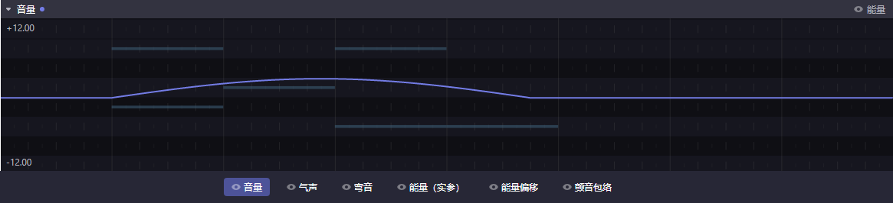

参数面板位于钢琴窗下半部分，`Ctrl+P` 显示 / 隐藏整个参数区（拖动标题栏可调整高度）。底部页签条列出当前片段可用的全部参数轨：

- **内置**：音量（±12 dB）、颤音包络。
- **声源提供的参数轨**：由引擎决定，如上图中示例声源提供的「气声」「弯音」「能量」。
- **效果器提供的参数轨**：片段效果链上的每个效果器都可以提供自己的参数轨。
- **属性参数**：通过「在参数栏编辑」从音符 / 音素属性钉选到参数面板的参数。
- **回显轨（只读）**：引擎报告的实际使用值。回显轨与同名的实参轨配对：点亮实参轨时会同时显示回显，右键可将回显**烘焙**到实参轨，在此基础上继续修改。

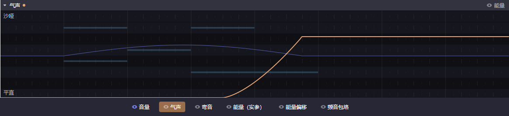

编辑手势：

| 操作 | 手势 |
|------|------|
| 画曲线 | 主键拖动 |
| 定值绘制（水平线） | `Ctrl` + 拖动 |
| 擦除 | 右键拖动 |
| 编辑锚点 | 锚点工具（`3`）下拖锚点、双击插入、右键删除 |
| 固定回显 | 固定笔刷（`4`）横刷 |
| 页签右键 | **从参数栏移除**（钉选的属性参数） |
| 标题栏右键 | **隐藏参数面板**、**关闭面板** |

参数轨的量程两端会显示引擎提供的说明文字（如图中的「平直 / 沙哑」）。分段轨（没有基线值的参数轨）在未绘制处为无值，这与连续轨的默认值不同。

### 多个参数面板

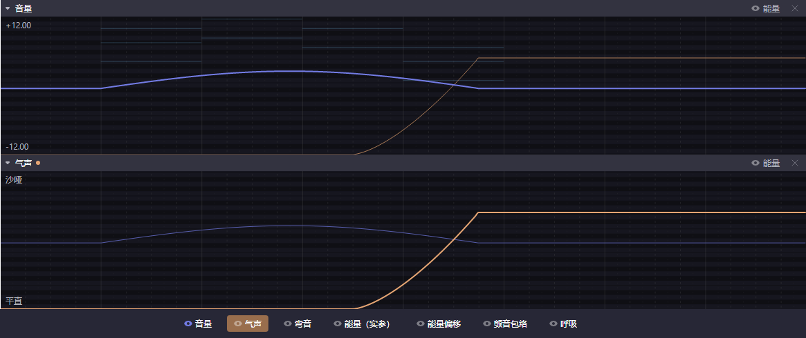

参数区可上下叠放多个面板，每个面板分别显示一条参数，可分别调整高度与收起，例如一个面板编辑音高相关参数，另一个固定显示音量。

- **添加 / 关闭**：页签条最左侧的 **+** 在焦点面板下方添加一个面板（沿用焦点面板的设置）；标题栏最右侧的 **×** 关闭该面板（仅剩一个面板时不显示）。右键单击 **+** 可直接关闭焦点面板。
- **焦点**：页签条只有一条，作用于**焦点面板**，其标题栏的参数名右侧有一个参数颜色的圆点。**按下标题栏**（单击或拖动）即可将该面板设为焦点；在面板中绘制参数不会切换焦点，因此可以固定显示若干面板，只用其中一个配合页签条切换参数。
- **收起**：单击标题栏左侧的三角可收起 / 展开该面板（收起后只显示标题栏）。
- **整个参数区**：`Ctrl+P` 或标题栏右键 **隐藏参数面板** 可隐藏整个参数区；隐藏期间页签条上的参数均不点亮，单击任一参数（或 **+**）即重新显示。
- **高度**：窗口高度不足时各面板按比例压缩（每个面板保留最小高度），窗口变大后自动恢复。
- **随工程保存**：面板布局保存在 `.tlpx` 工程中，重新打开时恢复（`.tlp` 格式不保存布局，打开时为单个面板）。调整布局不计入撤销，也不视为工程改动。

---

<!-- section: sidebar -->
## 11. 侧栏

侧栏页签自上而下是：**片段属性**、**效果**、**音符属性**、**Agent**、**脚本**、**扩展**、**导出**。

页签单击打开、再次单击关闭，打开的面板**并排显示**，例如同时打开片段属性与效果，可以一边调整参数一边查看效果链。面板按打开的先后排列：最先打开的紧邻页签条，之后打开的依次向左排列；如需调整顺序，关闭面板后重新打开即可。各面板宽度可分别调整，打开的面板及其宽度在下次启动时恢复。

窗口无法容纳更多面板时，其余页签变暗且不可点击，悬停提示会说明原因：需先关闭一个面板或加宽窗口。缩窄窗口时，已打开的面板先同步变窄；仍无法容纳时，最后打开的面板暂时收起，窗口加宽后自动恢复，不会被关闭。

### 11.1 属性页

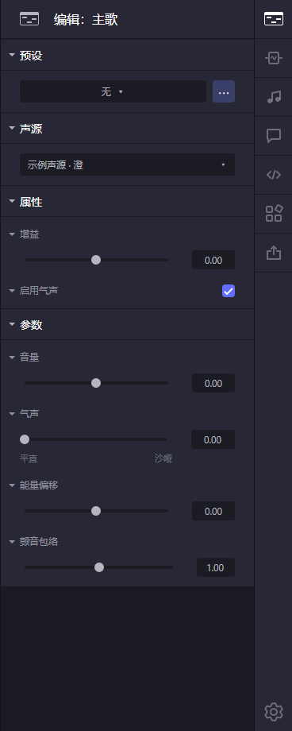

顶部标题显示当前编辑对象。片段属性自上而下为：

- **预设**：将整套片段设置（声源、属性、参数默认值）保存为预设，以便随时套用；`...` 按钮用于保存 / 删除。片段预设不包含效果链。
- **声源**：当前声源（歌声或乐器），可直接更换。
- **属性**：增益，以及引擎提供的片段级属性（如图中的「启用气声」这类开关会**决定部分参数轨是否出现**：取消勾选后已绘制的曲线被隐藏并保留，重新勾选后恢复）。
- **参数**：各参数轨的默认值（曲线未覆盖处使用该值）。

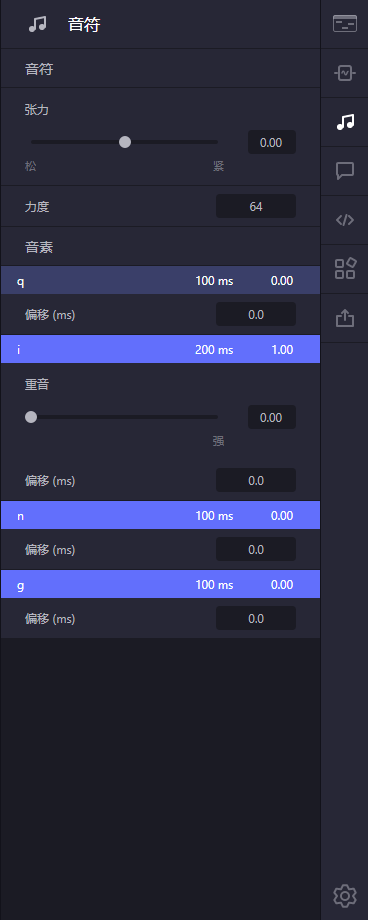

「效果」页签显示片段的效果链，作用对象与片段属性相同（同一个或同一批片段）：「+ 添加效果」添加效果器，效果链中的效果器可排序、删除，并可逐个展开参数。

「音符」页签显示选中音符的属性（引擎提供的音符级参数，如张力、力度），以及**音素**属性（按音素位置分别显示，核心音素与辅音的可编辑字段可以不同）。多选时字段合并显示，修改会应用到全部选中对象；值不一致处显示「(多个)」。

**收起字段**：分组标题与字段标题左侧均有三角，单击标题即可收起或展开。字段收起后只占一行，右侧显示当前值（滑条的数值、下拉框的选中项、勾选框的开 / 关、列表的项数、标签名等），收起时不可修改。收起状态按声源 / 效果器及字段分别记录：同一引擎的同一字段在其他片段、音符上同样保持收起，重启后仍然有效。

**恢复默认值**：在字段标题或控件上右键，选择「重置为默认」。适用于滑条、下拉框、文本框、列表及整个嵌套分组；多选时对全部选中对象生效，可撤销。

### 11.2 导出页

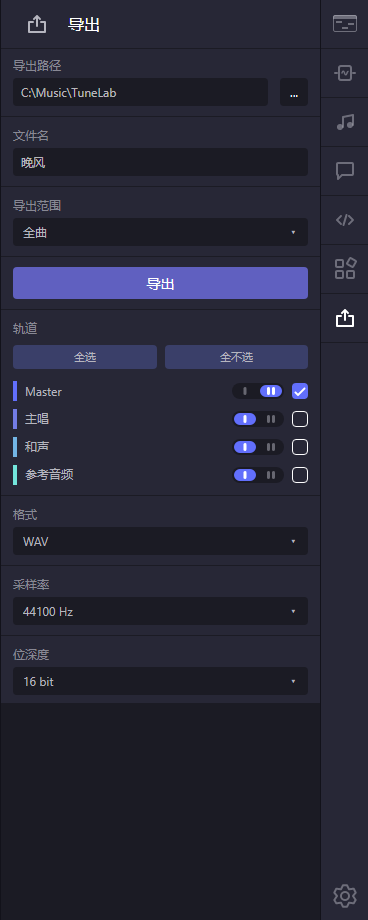

- **导出路径**、**文件名**、**导出范围**（全曲 / 选区，此处的「选区」指[编排区的范围选区](#范围选区daw-式常驻选区)，无选区时会提示）。
- **轨道**：勾选要导出的轨道（含 Master 总混音），每条轨道可分别选择**单声道 / 立体声**；「全选」「全不选」用于快速切换。勾选多条轨道时一次导出多个文件，文件名形如 `文件名_轨道名.wav`，导出时显示进度窗（第 i/n 条及当前轨道名）。
- **格式**：WAV / MP3 / FLAC / OGG。选择 WAV / FLAC 时可设置**采样率**与**位深度**，选择 MP3 / OGG 时可设置**比特率**。
- 以上选项随工程保存。

> 仅需整体混音的 WAV 时，使用菜单 **文件 → 导出混音文件** 更为便捷。

### 11.3 脚本页

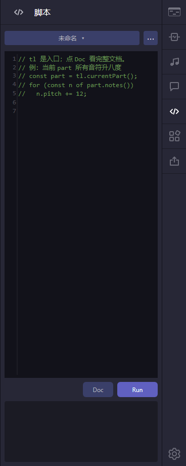

使用 JavaScript 脚本批量编辑工程，适用于「将第 5–8 小节的每个音符升高八度并添加三度和声」这类重复性操作。

- 顶部下拉框为当前脚本（新建脚本名为「未命名」），右侧 `...` 菜单提供**新建 / 打开 / 导入 / 保存 / 另存为 / 重命名 / 删除**；保存的脚本位于 `%APPDATA%\TuneLab\Scripts`。
- 中间为带行号与语法高亮的编辑器（新建脚本预置了说明 `tl` 为入口对象的注释）。单击 **Run** 或按 `Ctrl+Enter` 运行，下方输出区显示 `print` 的内容与运行结果。
- 单击 **Doc** 切换到随程序附带的**脚本 API 手册**（位于 `Resources/ScriptDoc/`），其中包含对象模型、坐标约定与增删改接口。
- **整段脚本为一个撤销单位**：`Ctrl+Z` 可一次撤销全部改动；脚本中途出错时，已做的改动全部回滚，工程不受影响。
- 定义了 `getScriptInfo` 的脚本会**自动出现在「脚本」菜单中**（按 category 分组），并按其声明的适用范围出现在音符、片段等右键菜单中，也可在设置的快捷键页绑定快捷键。

### 11.4 Agent 页

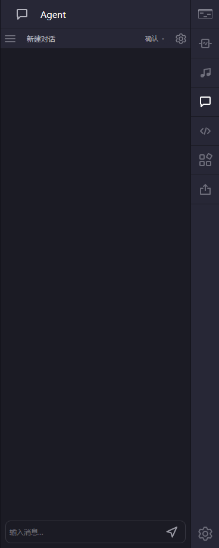

内置的 AI Agent 可以读取工程，并通过编辑器的命令与脚本 API（与脚本页相同）修改工程。

- 齿轮按钮打开**模型设置**：选择模型提供方，填写接口地址、API 密钥、模型名等。未连接时，输入框上方会提示先在设置中选择模型。
- **授权档位**（顶部下拉框）：
  - **确认**：每次改动需单击「应用」确认；
  - **只读**：只提供建议，不修改工程；
  - **自动**：自动应用改动。
- 每次改动会在对话中显示「Agent 想对工程应用 N 处改动」，可选择**应用 / 拒绝 / 重试**；修改设置、快捷键、扩展启停、覆盖脚本文件等敏感操作会单独请求确认。
- ☰ 按钮用于管理历史会话（新建、重命名、删除），会话保存在 `%APPDATA%\TuneLab\AgentSessions`。
- 输入框支持附加图片；下方显示 token 用量（当前上下文 / 本轮 / 会话累计）。
- 被中断的一轮会保留记录（中断位置及已生成的部分回复），可单击「继续」接着执行。
- **也可以询问使用方法**（如「颤音怎么画」「导出选区在哪」）：Agent 会查阅随软件发布的本手册后再回答；询问本机当前的快捷键或设置值时，Agent 读取的是实时数据。
- 工具清单与权限说明见 [agent-tools.md](agent-tools.md)；如需让**外部**工具（终端命令、CI、其他 AI 客户端）操作 TuneLab，见[命令行与外部工具](#17-命令行与外部工具)。

### 11.5 扩展页

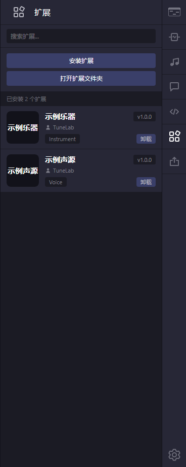

见[扩展管理](#15-扩展管理)。

---

<!-- section: settings -->
## 12. 设置

侧栏页签条最下方的齿轮按钮打开设置窗。设置窗左侧共七页，改动即时保存；标注「需重启」的项需重启 TuneLab 后才完全生效。

### 12.1 通用

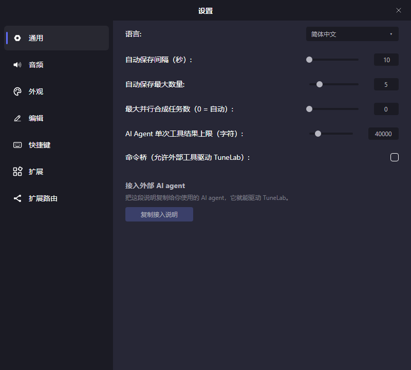

| 设置 | 说明 |
|------|------|
| 语言 | 界面语言（**需重启**）。默认跟随系统。 |
| 自动保存间隔（秒） | 10–60，默认 10 |
| 自动保存最大数量 | 保留几份备份，1–20，默认 5 |
| 最大并行合成任务数 | 0 = 自动（按 CPU 决定），默认 0 |
| AI Agent 单次工具结果上限（字符） | 限制单个工具结果提供给模型的字符数，默认 40000（约 1 万 token），0 表示不限制 |
| 命令桥（允许外部工具驱动 TuneLab） | 默认关闭。开启后，终端中的 `tunelab` 命令、CI 脚本与支持 MCP 的 AI 客户端可以操作当前打开的 TuneLab，见[命令行与外部工具](#17-命令行与外部工具) |

### 12.2 音频


| 设置 | 说明 |
|------|------|
| 总增益（分贝） | −24 ~ +24，默认 0，拖动即生效 |
| 音频驱动 / 音频设备 | 列出当前系统中可用的驱动与设备 |
| 采样率 | 32000 / 44100 / 48000 / 96000 / 192000，默认 44100 |
| 缓冲区大小 | 64 ~ 8192，默认 1024（值越小延迟越低，但越容易出现爆音） |
| 钢琴音采样 | 单击琴键试听时使用的 SoundFont（`.sf2`），留空时使用内置钢琴音色 |

### 12.3 外观


| 设置 | 说明 |
|------|------|
| 界面字体 | 从系统字体中选择；留空时使用内置字体及按语言优化的备用字体 |
| 自定义背景图 | 编辑器背景图片（png/jpg/bmp/gif/webp） |
| 背景图不透明度 | 0 ~ 1，默认 0.5，拖动即生效 |
| 轨道色相变化速率（度/秒） | 新建轨道自动配色时的色相变化速度，−720 ~ 720，默认 0 |

### 12.4 编辑


| 设置 | 说明 |
|------|------|
| 参数边界扩展（tick） | 绘制曲线或固定回显时，端点向外延伸写入的长度（1–60，默认 5） |
| 参数同步模式 | 开启后，**拖动音符时音高线与参数曲线随之平移**（默认关闭，曲线保持原位） |
| 自动生成发音 | 录入歌词时通过 G2P（汉字→拼音、假名→罗马字）填入发音字段，仅在输入时生效。默认开启 |

### 12.5 快捷键

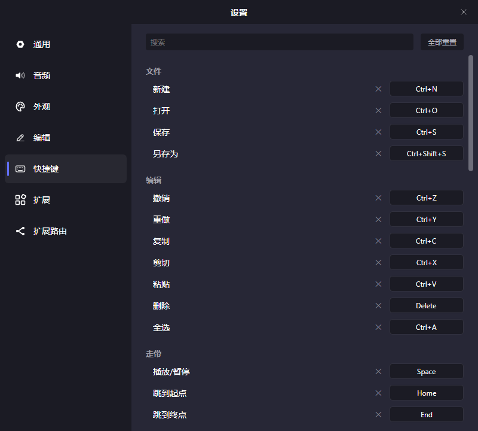

- 按功能分组（文件 / 编辑 / 走带 / 音符 / 片段 / 轨道 / 视图 / 应用 / 脚本），上方可搜索。
- 单击右侧的快捷键按钮开始录制，然后按下要设置的组合键；`×` 解除绑定。
- 冲突会即时提示：**同一区域**内冲突时询问是否改绑，并说明当前生效的绑定；**不同区域**使用同一快捷键时两者均保留，以聚焦区域的绑定优先。
- 「重置为默认」恢复单项，「全部重置」恢复全部。
- 仅保存**修改过的项**：未修改的项会随版本更新采用新的默认值。
- 脚本工具也在此绑定快捷键（默认无快捷键）。

### 12.6 扩展

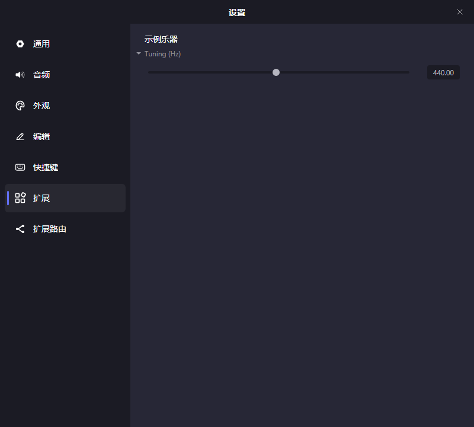

列出**提供设置项的扩展**，可逐个展开直接编辑。单击扩展名可收起或展开该组，收起状态会被记录（从扩展详情的齿轮按钮跳转时，目标扩展自动展开）。没有可配置的扩展时显示提示文字。扩展设置与 TuneLab 自身的设置分开存放，不写入 `Settings.json`。

### 12.7 扩展路由

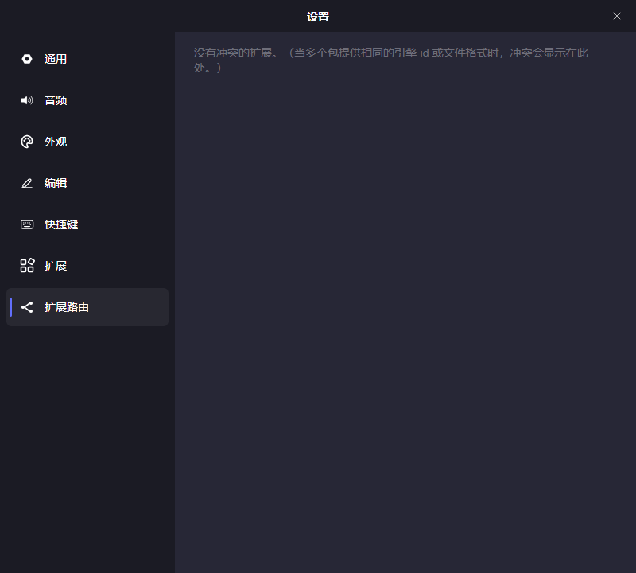

**多个扩展提供相同功能**（同一种音源或同一种文件格式）时，在此选择使用哪一个，按声源 / 乐器 / 效果 / 格式（导入、导出）分类列出。改动**重启后生效**。没有冲突时该页为空。

---

<!-- section: shortcuts -->
## 13. 快捷键

默认快捷键如下（完整列表见 [generated/keybindings.md](generated/keybindings.md)）：

| 命令 | 默认键 | 命令 | 默认键 |
|------|--------|------|--------|
| 新建 | `Ctrl+N` | 播放 / 暂停 | `Space` |
| 打开 | `Ctrl+O` | 跳到起点 | `Home` |
| 保存 | `Ctrl+S` | 跳到终点 | `End` |
| 另存为 | `Ctrl+Shift+S` | 重新打开上一个片段 | `Ctrl+Tab` |
| 撤销 | `Ctrl+Z` | 显示/隐藏参数面板 | `Ctrl+P` |
| 重做 | `Ctrl+Y` | 全屏 | `F11` |
| 用户手册 | `F1` | | |
| 复制 / 剪切 / 粘贴 | `Ctrl+C` / `X` / `V` | 音符工具 … 颤音工具 | `1` … `5` |
| 删除 | `Delete` | 升 / 降半音 | `↑` / `↓` |
| 全选 | `Ctrl+A` | 升 / 降八度 | `Shift+↑` / `Shift+↓` |

作用范围：`↑ ↓` 等快捷键仅在钢琴窗中生效，编辑区级命令在编排区与钢琴窗中均生效；内层区域的绑定优先。

常用修饰键：

| 修饰键 | 含义 |
|--------|------|
| `Shift` + 拖动（空白处） | 画范围选区 |
| `Shift` + 拖动（音符，音符工具） | 约束移动：只改音高 |
| `Ctrl` + 单击 | 加选 / 减选 |
| `Ctrl` + 拖动（画笔类工具） | 定值绘制（水平线） |
| `Alt` + 拖动 | 临时取消吸附 |
| 右键拖动（画笔类工具） | 擦除 |
| 中键拖动 | 平移视图（编排区与钢琴窗通用） |
| 滚轮 | 纵向滚动（钢琴窗滚音高、编排区滚轨道） |
| `Shift` + 滚轮 | 横向平移时间 |
| `Ctrl` + 滚轮 | 横向缩放（以指针处为轴） |
| `Ctrl+Shift` + 滚轮 | 纵向缩放音高（仅钢琴窗） |
| 触控板双指横滑 | 横向平移时间 |

---

<!-- section: files -->
## 14. 文件、格式与自动保存

### 工程格式

| 后缀 | 说明 |
|------|------|
| `.tlpx` | TuneLab 工程（CBOR），**默认保存格式** |
| `.tlp` | TuneLab 工程（JSON），可用文本编辑器查看 |
| `.mid` / `.midi` | MIDI，支持导入与导出（仅包含音符与时间信息） |

其他软件的工程格式由**格式扩展**提供，安装后自动出现在打开对话框与 **文件 → 导出为** 子菜单中。

### 导入

- **文件 → 导入音频轨道**：wav / mp3 / flac / ogg / aiff（aif、aifc）。
- **文件 → 导入工程轨道**：从其他工程中选择轨道导入。对话框中可选择**与工程对齐节奏**、**导入节奏**、**导入节拍**。
- 将工程文件拖入窗口即可打开；拖入 `.tlx` 文件则安装扩展。

### 导出

| 入口 | 产出 |
|------|------|
| 侧栏 **导出** 页 | 分轨或总混音频，可选择格式、采样率、位深 / 比特率与范围 |
| **文件 → 导出混音文件** | 整体混音的 WAV 文件 |
| **文件 → 导出为 → …** | 工程文件（MIDI 或格式扩展提供的格式） |
| 片段右键 → **导出音频** | 仅导出该片段 |

### 自动保存与崩溃恢复

- 按设定的间隔自动备份到 `%APPDATA%\TuneLab\AutoSave`，最多保留设定的份数。
- 程序异常退出后再次启动时会询问：「程序上次异常退出。是否打开自动备份文件？」
- 对于从备份恢复的工程，可通过菜单 **文件 → 存回原位** 写回原文件（会先确认「用恢复出来的内容替换这个文件？」）。该菜单项仅在当前工程来自崩溃恢复且原文件仍存在时显示。

---

<!-- section: extensions -->
## 15. 扩展管理

TuneLab 的合成引擎、乐器、效果器与工程格式均以扩展（`.tlx` 包）形式提供。

### 安装与卸载

- **拖入窗口**：将 `.tlx` 文件拖入编辑器。
- **侧栏扩展页 → 安装扩展**：选择文件安装。
- 安装与卸载均在**重启后生效**；卸载会先标记为「待卸载」，可通过「取消卸载」撤销。
- 「打开扩展文件夹」打开 `%APPDATA%\TuneLab\Extensions`。
- 已安装的扩展显示为卡片：图标、名称、版本、作者、类别徽标（Voice / Instrument / Effect / Format …）。单击卡片打开**详情窗**，显示扩展作者提供的介绍；没有附带介绍的扩展会注明。

### 启停

可在详情窗中**按扩展包**或**按单项功能**启用或禁用（重启后生效）。整个扩展包被禁用时，其中的单项功能无法单独启用。启用状态保存在 `Configs\ExtensionActivation.json`。

### 冲突与路由

多个扩展提供相同的音源或文件格式时，在 **设置 → 扩展路由** 中指定使用哪一个（重启后生效）。

### 自己写扩展

见 [plugin-development.zh-CN.md](plugin-development.zh-CN.md)（英文版 [plugin-development.md](plugin-development.md)）。SDK 的演进规则见 [sdk-api-evolution.md](sdk-api-evolution.md)。

---

<!-- section: troubleshooting -->
## 16. 更新与排错

- **用户手册**：菜单 **帮助 → 用户手册**（`F1`）在应用内打开本手册：单击左侧目录跳转到对应章节，正文中的插图**单击可放大**（滚轮缩放、拖动平移、`Esc` 关闭），无需联网。
- **检查更新**：菜单 **帮助 → 检查更新...**。有新版本时弹窗显示版本号、发布时间与更新说明，可选择**更新 / 稍后 / 忽略**。安装版会下载安装器并在退出时完成更新；自动更新失败时改为在浏览器中打开下载页面。免安装版不支持自动更新。
- **日志**：**帮助 → 打开日志**。日志按启动时间分文件保存，记录版本号、构建标识与扩展 SDK 版本，报告问题时请附上日志。
- **关于**：**帮助 → 关于 TuneLab** 显示版本与许可证信息。
- 常见问题：

| 现象 | 排查方法 |
|------|----------|
| 没有声音 | 设置 → 音频中的驱动与设备；轨道的静音 / 独奏；总增益；片段是否已设置声源 |
| 音符无声 / 状态带一直显示「待合成」 | 声源引擎是否已安装并成功初始化（引擎初始化失败时启动会弹出错误框，详见日志） |
| 状态带显示红色 | 悬停查看错误信息，右键复制错误信息；效果器出错时改为播放未处理的音频 |
| 更换扩展后未生效 | 扩展的安装、卸载、启停与路由均需**重启**后生效 |
| 音频片段显示加载失败 | 音频文件已被移动，双击片段重新链接 |

---

<!-- section: command-line -->
## 17. 命令行与外部工具

除侧栏的 AI Agent 外，TuneLab 也可由**外部工具**操作：终端命令、CI 脚本，或其他支持 MCP 的 AI 客户端。它们使用与 Agent 面板**相同的命令**（读取工程、运行脚本、修改设置、执行编辑器操作等），因此可执行的操作与授权规则完全一致。

### 17.1 开启命令桥

**设置 → 通用 → 命令桥（允许外部工具驱动 TuneLab）**，默认**关闭**。

开启后，TuneLab 在本机创建一条命名管道，凭据保存在 `%APPDATA%\TuneLab\Configs\CommandBridge.json`；仅**同一 Windows 用户**的进程可以连接，不监听网络端口。关闭开关即断开连接。

### 17.2 命令行 `tunelab`

安装版的安装目录（`%LocalAppData%\Programs\TuneLab`）中提供 `tunelab.cmd`；免安装版使用同目录下的 `TuneLab.Cli.exe`（参数相同）。安装程序**不会**修改 PATH，如需在任意目录使用 `tunelab`，请将安装目录添加到 PATH。

| 用法 | 说明 |
|------|------|
| `tunelab --help` | 列出全部命令（按主题分组），无需运行 TuneLab |
| `tunelab <组> <命令> --help` | 显示该命令的说明与参数 |
| `tunelab project status` | 在**当前打开的工程**中执行（需已开启命令桥） |
| `tunelab --headless <组> <命令>` | 启动一个无界面的 TuneLab 执行命令；`--project <文件>` 指定工程 |
| `tunelab --commands <文件>` | 依次执行文件中的多条命令（同一进程、同一工程，后续命令可见前序命令的改动），常用于 CI |
| `tunelab --search <正则>` | 搜索提及该词的命令 |
| `tunelab <组> <命令> --json` | 以结构化 JSON 输出结果，便于脚本处理 |

退出码：`0` 成功 / `1` 命令失败 / `2` 参数错误 / `3` 无法连接 TuneLab。

**授权**：会修改内容的命令默认在终端中请求确认一次（`--yes` 跳过确认，`--dry-run` 只报告不执行）。但 `--yes` **不能绕过 Agent 面板顶部的授权档位**：设为「确认」时仍需确认，设为「只读」时不会执行任何修改，命令输出中会说明具体情况。

### 17.3 接进支持 MCP 的 AI 客户端

`tunelab mcp` 通过 MCP 协议向外部客户端提供同一套命令（经 stdin/stdout 通信，无需手动运行）。在客户端的服务器配置中填写：

```json
{
  "command": "C:\\Users\\<你的用户名>\\AppData\\Local\\Programs\\TuneLab\\TuneLab.Cli.exe",
  "args": ["mcp"]
}
```

`tunelab mcp --help` 会输出本机的实际路径，可直接复制使用。

- 工具按主题分组（`project_read` / `project_edit` / `script_edit` / `action_edit` …），每个工具接收一个 `subcommand` 及其参数；`tunelab_help` 可获取任一命令的完整说明。
- **列出工具无需运行 TuneLab**；执行命令时需要 TuneLab 正在运行并已开启命令桥，否则工具会返回提示，说明需要先启动 TuneLab 并开启命令桥，工具本身不会从列表中消失。
- 通过 MCP 执行时**不会弹出确认框**（客户端有自己的批准界面）：改动能否执行取决于 Agent 面板中设置的授权档位，设为「确认」时，外部客户端的改动会被拒绝。

> 命令体系的完整设计见 [command-surface.md](command-surface.md)；Agent 的工具清单与权限说明见 [agent-tools.md](agent-tools.md)。

---

<!-- section: glossary -->
## 附录：术语表

| 术语 | 含义 |
|------|------|
| **轨道 Track** | 编排区的一行，含增益/声像/静音/独奏。 |
| **片段 Part** | 轨道上的一段内容。歌声片段与乐器片段承载音符，音频片段承载一个音频文件。 |
| **声源 / 乐器** | 片段的音源：声源（voice）合成单声部歌声，乐器（instrument）可在同一片段内演奏和声。两者择一。 |
| **效果器 Effect** | 挂在片段上的离线音频处理，按效果链顺序处理，可提供自己的参数轨。 |
| **参数轨 Automation** | 一条随时间变化的曲线（音量、气声、颤音包络…）。连续轨有基线值，分段轨没有（未绘制处为无值）。 |
| **回显轨** | 引擎报告的实际使用值，以只读曲线显示，可烘焙到同名实参轨。 |
| **音素 Phoneme** | 一个音符实际合成的发音单元序列，由引擎生成；拖动分界线会将其锁定为用户数据。 |
| **量化 Quantization** | 拖动时的吸附精度；按住 `Alt` 可临时关闭。 |
| **范围选区** | 常驻的时间选区（编排区是「时间 × 轨道」，钢琴窗是一条时间带），`Shift` + 拖动创建。 |
| **扩展 Extension** | 以 `.tlx` 包形式提供声源、乐器、效果器、格式等功能。 |
